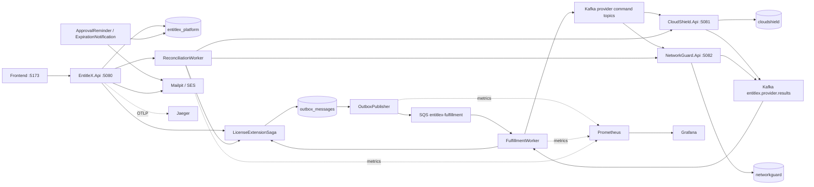
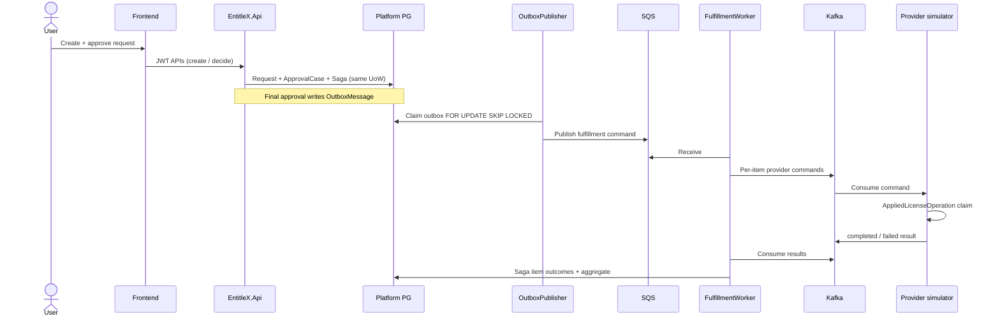
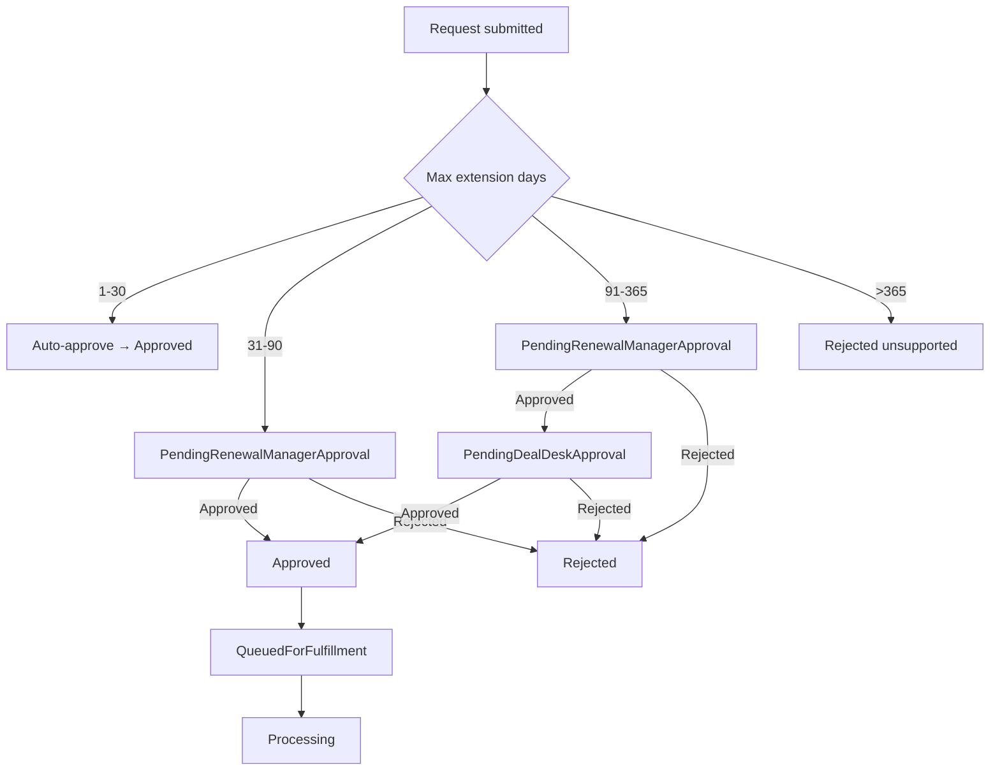
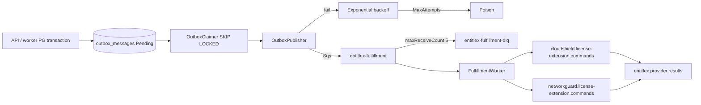

# EntitleX system architecture

Phase 12 view of the running system: modular control-plane API, durable saga, transactional outbox, SQS/Kafka messaging, vendor simulators, reconciliation, scheduled lambdas, and local observability stack.

## Components

| Layer | Processes |
|-------|-----------|
| UI | Vite React frontend (`:5173`) → proxies to API |
| Control plane | `EntitleX.Api` (`:5080`) — JWT Minimal APIs, MediatR, EF Core |
| Async workers | OutboxPublisher, FulfillmentWorker, ReconciliationWorker, NotificationService |
| Scheduled | ApprovalReminder, ExpirationNotification (Lambda hosts / EventBridge) |
| Simulators | CloudShield.Api (`:5081`), NetworkGuard.Api (`:5082`) |
| Data | Postgres DBs `entitlex_platform`, `cloudshield`, `networkguard` |
| Messaging | LocalStack SQS (`entitlex-fulfillment` + DLQ), Kafka topics |
| Observability | Jaeger (OTLP), Prometheus, Grafana, Serilog |

## System flowchart

## Happy-path request sequence

## Approval workflow (bands)

Timeouts: `ApprovalPending` → `Escalated` (not auto-approved). Reminder Lambda may email then apply configurable terminal state (default `Escalated`).

## Messaging topology (outbox)

## Observability

- **Traces**: OpenTelemetry → Jaeger `:16686` (W3C `traceparent`)
- **Metrics**: API/simulators `GET /metrics`; workers HttpListener `:9180–9183`; Grafana `:3001`
- **Logs**: Serilog structured console; CloudWatch path documented in [observability.md](observability.md)

## Related docs

- [system-design.md](system-design.md) — decisions and tradeoffs
- [database-schema.md](database-schema.md) — tables
- [event-contracts.md](event-contracts.md) — envelopes
- [saga-workflow.md](saga-workflow.md) — state machine
- [diagrams/README.md](diagrams/README.md) — diagram index
