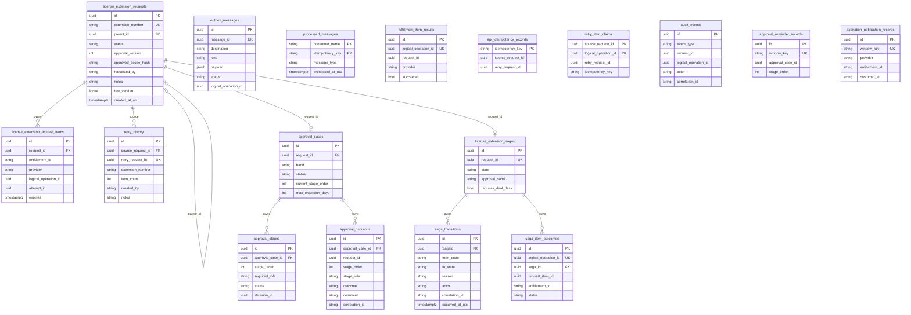
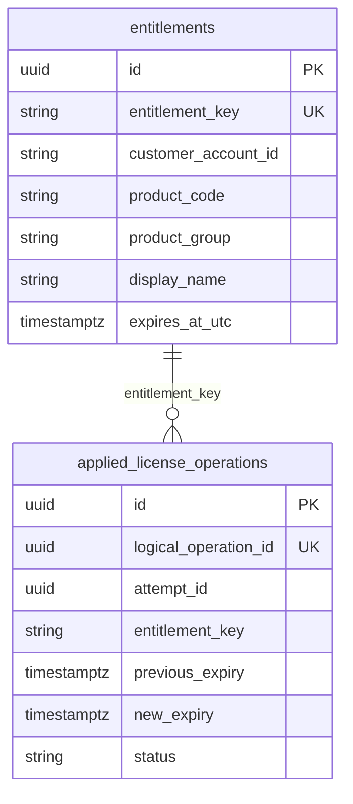
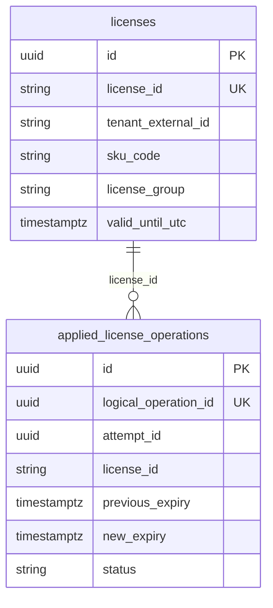

# Database schema

Three PostgreSQL databases (Compose init: `infra/docker/postgres/init-databases.sh`):

| Database | DbContext | Owner |
|----------|-----------|-------|
| `entitlex_platform` | `EntitleXDbContext` | Control plane, workers, lambdas |
| `cloudshield` | `CloudShieldDbContext` | CloudShield simulator |
| `networkguard` | `NetworkGuardDbContext` | NetworkGuard simulator |

Schema names are `public`. Tables below match EF models / migrations (inventory Phase 12).

## Platform ER (`entitlex_platform`)

### Platform table notes

| Table | Role |
|-------|------|
| `license_extension_requests` | Aggregate root; self-FK `parent_id` (Restrict) for retry chains |
| `license_extension_request_items` | Cascade from request; carries `logical_operation_id` + `attempt_id` |
| `retry_history` | Appended on selective retry |
| `approval_cases` / `stages` / `decisions` | Sequential role-gated approval |
| `license_extension_sagas` / `transitions` / `item_outcomes` | Durable saga ledger |
| `outbox_messages` | Transactional outbox (`Pending`/`Processing`/`Published`/`Poison`) |
| `processed_messages` | Consumer idempotency composite PK |
| `fulfillment_item_results` | Local fulfillment ledger (unique `(logical_operation_id, attempt_id)`) |
| `api_idempotency_records` / `retry_item_claims` | Selective-retry HTTP + concurrency |
| `audit_events` | Append-only audit (recon + ops) |
| `approval_reminder_records` / `expiration_notification_records` | Lambda idempotency windows |

## CloudShield ER (`cloudshield`)

## NetworkGuard ER (`networkguard`)

Provider apply: unique `logical_operation_id` makes double-apply a no-op success (idempotent replay).

## Related

- [architecture.md](architecture.md)
- [idempotency.md](idempotency.md)
- [saga-workflow.md](saga-workflow.md)
