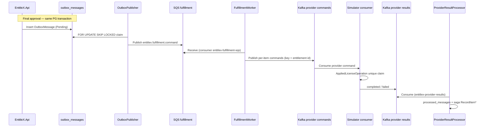
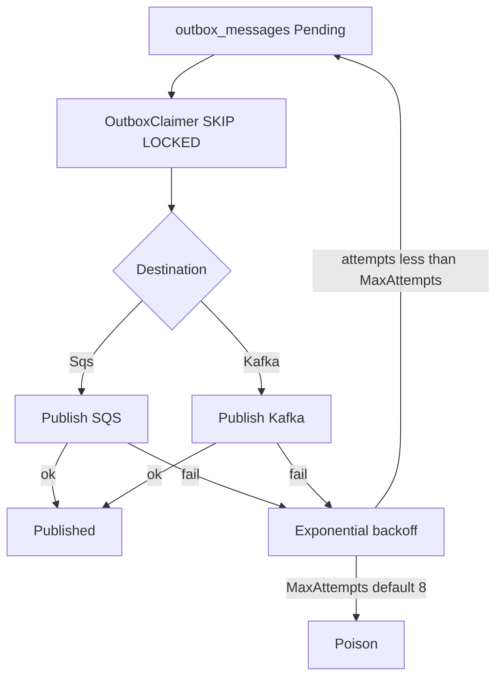

# EntitleX event contracts (Phase 5+)

Integration messages use a versioned envelope. Schema version stubs start at `"1"`; payload DTOs are suffixed `V1`. Contracts live under `src/EntitleX.Messaging/Contracts/`.

## Envelope

| Field | Purpose |
|-------|---------|
| `schemaVersion` | Contract version (`"1"`) |
| `messageType` | Stable type name (see below) |
| `messageId` | Unique id for this message (consumer idempotency) |
| `correlationId` | End-to-end correlation across the operation |
| `causationId` | Parent `messageId` that caused this message |
| `requestId` | License-extension request id when applicable |
| `logicalOperationId` | Stable item intent id (survives selective retries) |
| `occurredAtUtc` | Producer timestamp |
| `payload` | Typed JSON body |

CLR type: `MessageEnvelope`.

## Message types

| Type constant (`MessageTypes`) | Payload DTO | Transport |
|--------------------------------|-------------|-----------|
| `entitlex.fulfillment.command` | `FulfillmentCommandV1` (+ `FulfillmentItemV1`) | Legacy Outbox → SQS (opt-in `EnableSqsDispatcher`) |
| `entitlex.provider.license-extension.command` | `ProviderLicenseExtensionCommandV1` | Kafka provider topics |
| `entitlex.provider.license-extension.completed` | `ProviderLicenseExtensionCompletedV1` | Kafka results |
| `entitlex.provider.license-extension.failed` | `ProviderLicenseExtensionFailedV1` | Kafka results |

## Topics / queues (local Compose)

| Resource | Default name | Config key |
|----------|--------------|------------|
| SQS fulfillment | `entitlex-fulfillment` | `Messaging:Sqs:FulfillmentQueueName` |
| SQS DLQ | `entitlex-fulfillment-dlq` (maxReceiveCount 5) | `Messaging:Sqs:FulfillmentDlqName` |
| Kafka CloudShield commands | `cloudshield.license-extension.commands` | `Messaging:Kafka:CloudShieldCommandsTopic` |
| Kafka NetworkGuard commands | `networkguard.license-extension.commands` | `Messaging:Kafka:NetworkGuardCommandsTopic` |
| Kafka provider results | `entitlex.provider.results` | `Messaging:Kafka:ProviderResultsTopic` |

Consumer groups: `entitlex-fulfillment`, `entitlex-orchestrator-results`, `cloudshield-commands`, `networkguard-commands`.

LocalStack init: `infra/docker/localstack/init-sqs.sh`.

## Messaging sequence

## Outbox publish loop

Options: `Messaging:Outbox` (`BatchSize`, `PollIntervalMilliseconds`, `LockDurationSeconds`, `MaxAttempts`, `BaseRetryDelaySeconds`, `MaxRetryDelaySeconds`). Host: `EntitleX.OutboxPublisher`.

## Delivery semantics

- **At-least-once** on SQS and Kafka.
- Consumers stage `(consumerName, idempotencyKey)` in `processed_messages` in the **same** unit of work as business side effects (claim-before-flush is incorrect). Provider-result keys use `result:{LogicalOperationId}:{AttemptId}`.
- Fulfillment SQS: leave message on failure (visibility timeout retry); after repeated failures, move to DLQ.
- Outbox publisher: `FOR UPDATE SKIP LOCKED`, exponential retry, `Poison` after `MaxAttempts`.
- Flow summary (preferred, `PreferDirectKafka=true`): approval final → outbox Kafka provider commands (same PG txn) → `OutboxPublisher` → simulator consumers → results topic → `EntitleX.ResultsWorker` / `ProviderResultProcessor`.
- Legacy hop (`PreferDirectKafka=false` + `EnableSqsDispatcher=true`): outbox → SQS → `FulfillmentCommandProcessor` → Kafka per-item outbox rows.
