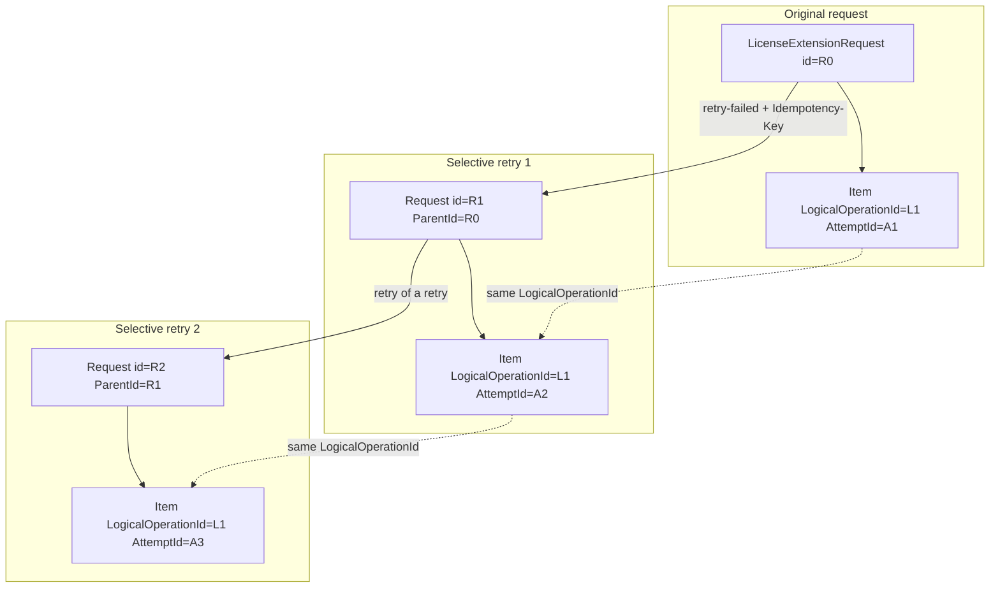

# Idempotency and selective retry

Phase 7 adds **selective retry** for failed license-extension items, with
DB-backed idempotency so lost HTTP responses and concurrent callers cannot
double-dispatch overlapping work.

## API

```
POST /api/v1/license-extensions/{requestId}/retry-failed
Authorization: Bearer <RenewalRepresentative|PlatformAdmin JWT>
Idempotency-Key: <client-generated opaque key>   # required (header or body)
Content-Type: application/json

{
  "notes": "optional operator note",
  "logicalOperationIds": ["optional-filter-guid", "..."]
}
```

Returns `201 Created` with the new request DTO (`Location` →
`/api/v1/license-extension-requests/{newId}`).

**Lost-response replay:** the same `Idempotency-Key` for the same source returns
the **prior** retry request (same id). No second claim, no second outbox write.

## Retry lineage (ParentId / AttemptId / LogicalOperationId)



| Field | Behavior |
|---|---|
| Failed items only | Selected from saga `Failed` outcomes (optional LogicalOperationId filter) |
| `LogicalOperationId` | **Preserved** (provider idempotency key) |
| `AttemptId` | **New** per retry item |
| `ParentId` | Points at the immediate source (multi-generation chains supported) |
| `ExtensionNumber` | New unique business number |
| Approvals | Reused when parent `ApprovedScopeHash` is still valid for the failed items; otherwise a new approval band is evaluated |
| History | Source `retry_history` + retry `notes` |

Succeeded siblings are **never** copied (forward recovery).

`LogicalOperationId` type: `EntitleX.BuildingBlocks.Ids.LogicalOperationId` (readonly record struct over `Guid`). Unique indexes:

| Table | Uniqueness |
|---|---|
| `saga_item_outcomes` | `(saga_id, logical_operation_id)` — scoped per saga so child retries can seed the same LogicalOp |
| `fulfillment_item_results` | `(logical_operation_id, attempt_id)` — one ledger row per attempt |
| Provider `applied_license_operations` | `logical_operation_id` (provider apply idempotency) |

Provider-result consumer claim key: `result:{LogicalOperationId}:{AttemptId}` in `processed_messages`.

## Reconcile-uncertain gate (Phase 8)

Before claiming, `IReconciliationGate` (`ReconciliationGate`) blocks retry when:

- Saga state is `ReconciliationRequired`, or
- Any item outcome is `Uncertain`, or
- Local `fulfillment_item_results` shows Success while the saga still has
  `Failed` / `Pending` for the same `LogicalOperationId`

Repair those cases via reconciliation (`docs/reconciliation.md`) before retry.

## DB-backed claims (short Postgres transaction)

Two tables participate in the **same** unit of work as the new request, approval
case, saga seed, and fulfillment **outbox** row:

| Table | Role |
|---|---|
| `api_idempotency_records` | Unique `idempotency_key` → `retry_request_id` (lost-response) |
| `retry_item_claims` | Unique `(source_request_id, logical_operation_id)` — blocks concurrent overlapping retries of the same source items. Claims whose child retry is terminal `Failed`/`Rejected` are released so a later retry can proceed. |

**Transaction boundary:** Postgres only. The API never holds a DB transaction
open across Kafka, SQS, or outbound HTTP. Async fulfillment is dispatched by
writing the transactional outbox; workers publish after commit.

Store: `EfRetryClaimStore` (`IRetryClaimStore`) — `FindByIdempotencyKeyAsync`, `TryClaimItemsAsync`. Handler: `RetryFailedLicenseExtensionsCommandHandler`.

### Concurrency matrix

| Scenario | Outcome |
|---|---|
| Same key, sequential | Second call returns prior retry |
| Same key, concurrent | One insert wins; loser re-reads idempotency record |
| Different keys, same failed items | One claim wins; other → `409 Conflict` |
| Multi-generation (retry of a retry) | Claims are scoped to the **immediate** source request id |

## Consumer / provider layers

| Mechanism | Table / type | Behavior |
|---|---|---|
| Consumer at-least-once | `processed_messages` | PK `(consumer_name, idempotency_key)` |
| Provider apply | unique `logical_operation_id` on `AppliedLicenseOperation` | Already-applied returns success without re-extend |

## AuthZ

Requires `CanCreateRequests` (`RenewalRepresentative` or `PlatformAdmin`). The
handler also re-checks those roles so MediatR callers cannot bypass the policy.

## Related

- `docs/saga-workflow.md` — forward recovery and item outcomes
- `docs/event-contracts.md` — fulfillment / provider envelopes
- `docs/reconciliation.md` — gate before retry
- EF migration `SelectiveRetryIdempotency`
