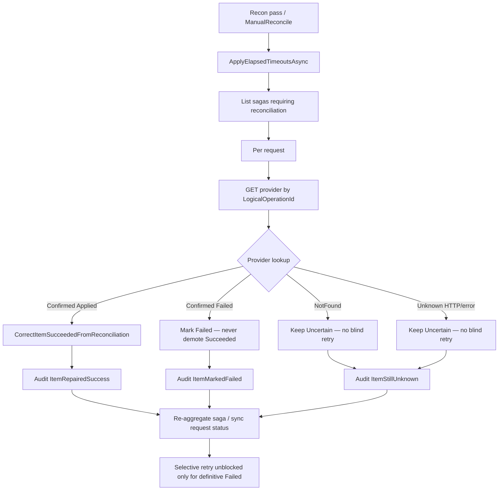

# Reconciliation and failure repair

Phase 8 adds scheduled and manual **reconciliation** so uncertain provider
outcomes can be repaired without blind-retrying unknown external effects.

## Goals

1. Find timeouts, missing completions, uncertain outcomes, and local↔provider mismatches.
2. For each candidate: `LogicalOperationId` → provider status → repair local state.
3. Never POST a new extension when the provider effect is unknown.
4. Emit corrective **audit events** for every repair / unknown / mismatch decision.

## Worker

`EntitleX.ReconciliationWorker` (every ~30s, `take: 50`, actor `"reconciliation-worker"`):

1. Apply elapsed saga timeout hooks (`ApprovalPending` → Escalated,
   `FulfillmentProcessing` → `ReconciliationRequired` + Uncertain items).
2. List sagas requiring reconciliation.
3. For each request, run `IReconciliationService.ReconcileRequestAsync`.

Service: `ReconciliationService` (`Application/Reconciliation/ReconciliationService.cs`).
Probe: `IProviderOperationStatusClient.GetByLogicalOperationIdAsync` (CloudShield/NetworkGuard HTTP GET).

## Decision / repair flow



## Decision matrix

| Provider lookup (`AppliedLicenseOperation`) | Local action |
|---|---|
| **Confirmed Applied** | Repair saga item → `Succeeded` (even if local was `Failed`); backfill `fulfillment_item_results`; audit `ItemRepairedSuccess` |
| **Confirmed Failed** | Mark saga item → `Failed` (retry-eligible); never demote local `Succeeded`; audit `ItemMarkedFailed` |
| **NotFound** | Keep / re-mark `Uncertain`; stay in `ReconciliationRequired`; **no blind retry**; audit `ItemStillUnknown` |
| **Unknown** (HTTP/error/ambiguous) | Same as NotFound — leave unresolved |

## Manual admin API

```
POST /api/v1/admin/reconciliation/requests/{requestId}
Authorization: Bearer <PlatformAdmin JWT>
```

Returns the reconciliation run result (saga state, per-item actions,
`stillRequiresReconciliation`). AuthZ: `CanManageReconciliation` /
`PlatformAdmin` only (endpoint policy + handler re-check).

Ops backlog: `GET /api/v1/admin/ops/summary` (`CanManageReconciliation`).

## Selective-retry gate (Phase 7 → Phase 8)

`IReconciliationGate` production implementation is `ReconciliationGate`:

- Blocks when saga is `ReconciliationRequired` or any outcome is `Uncertain`
- **Real check:** blocks when the local fulfillment ledger shows Success while
  the saga still has `Failed` / `Pending` for the same `LogicalOperationId`

Retry remains blocked until reconciliation clears uncertain / mismatched items.
Confirmed failures become selective-retry eligible (Phase 7).

## Idempotency

- Provider simulators enforce unique `LogicalOperationId` on `AppliedLicenseOperation`
  (double apply is a no-op replay).
- Platform `fulfillment_item_results` is unique on `LogicalOperationId`.
- Saga corrective methods are idempotent when the item is already `Succeeded`.

## Audit

Table `audit_events` (migration `ReconciliationAudit`) records:

| Event type | When |
|---|---|
| `Reconciliation.PassStarted` | Worker / service pass begins |
| `Reconciliation.ManualTriggered` | PlatformAdmin endpoint |
| `Reconciliation.ItemRepairedSuccess` | Local repaired from provider Applied |
| `Reconciliation.ItemMarkedFailed` | Definitive provider failure |
| `Reconciliation.ItemStillUnknown` | NotFound / Unknown — no blind retry |
| `Reconciliation.MismatchDetected` | Local↔provider disagreement |
| `Reconciliation.BatchCompleted` | Pass finished |

## Request insights (Explain + RCA)

Read-only operator helpers (no writes; Manual Reconcile / Retry stay explicit):

| Endpoint | Auth | Purpose |
|---|---|---|
| `GET /api/v1/license-extension-requests/{id}/explain` | CanReadApprovals + resource read | Natural-language status from request/approval/saga/audit/ledger/poison + live probes for Uncertain items |
| `GET /api/v1/admin/reconciliation/requests/{id}/rca` | PlatformAdmin | Reconciliation RCA emphasizing Uncertain, ledger mismatches, probes, poison outbox |

Insights are **deterministic Fallback by default** (`AiAssist:Enabled=false`). Optional local Ollama (Microsoft.Extensions.AI + OllamaSharp, `BaseUrl` e.g. `http://127.0.0.1:11434`) may return a **validated structured `IncidentDiagnosis`** (`rootCauseCategory`, confidence, evidence step ids, recommended action). Top-level `recommendedAction`, citations, and facts stay composer-authored. Unvalidated model output is never returned. No Bedrock / SageMaker / paid cloud LLM is required — keep AWS lab on Fallback. Details: [ai-agent.md](ai-agent.md).

## Related

- `docs/failure-scenarios.md` — failure injection stubs
- `docs/saga-workflow.md` — forward recovery + `ReconciliationRequired`
- `docs/idempotency.md` — selective retry after definitive failures
