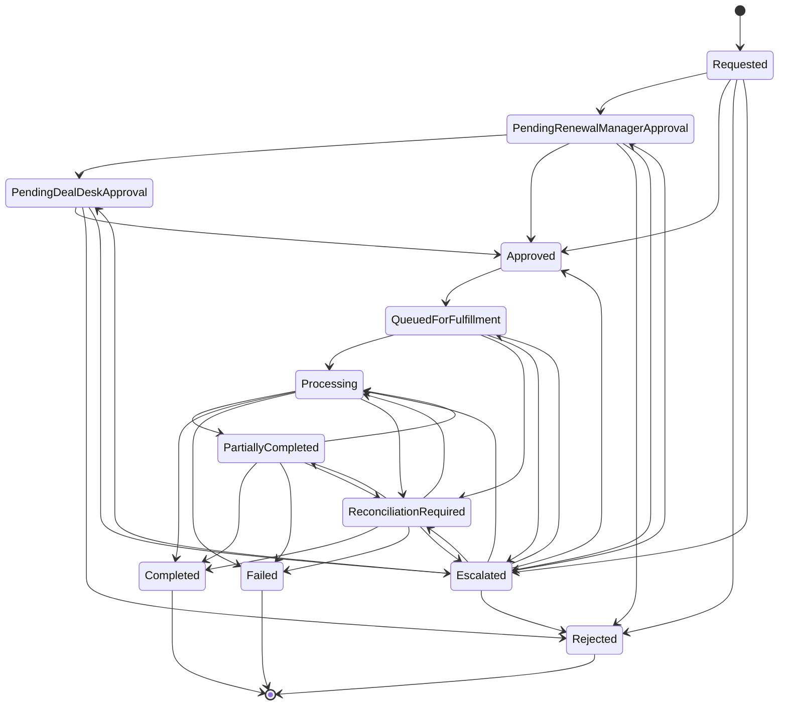

# License-extension saga workflow

Phase 6 introduces a **durable centralized saga** (`LicenseExtensionSaga`) that orchestrates approval ordering, fulfillment dispatch, item outcomes, and request-status aggregation for each `LicenseExtensionRequest`.

Source of truth: `src/EntitleX.Domain/Saga/LicenseExtensionSaga.cs` (`AllowedTransitions`, `SagaState`, `SagaTimeoutKind`).

## Why forward recovery (not compensation)

License extensions **grant additional entitlement time**. Once a provider has successfully extended an entitlement:

- The customer already holds a longer valid-to date.
- Rolling that success back would revoke legitimate coverage (a compensating “shorten expiry” is not a safe or product-supported inverse).
- Sibling failures must not punish successful extensions.

Therefore the saga uses **forward recovery only**:

1. Persist each item outcome independently.
2. On mixed results, move to `PartiallyCompleted` / request `PartiallyFulfilled`.
3. Leave successful `LogicalOperationId`s untouched.
4. Later phases (selective retry) copy **only failed items**, keep `LogicalOperationId`, mint a new `AttemptId`, and chain via `ParentId`.

There is **no** compensating transaction that undoes a successful provider extension.

## Saga states

| Saga state | Meaning |
|---|---|
| `Requested` | Saga opened for the request |
| `PendingRenewalManagerApproval` | Awaiting Renewal Manager |
| `PendingDealDeskApproval` | RM approved; awaiting Deal Desk (91–365 day band) |
| `Approved` | Final approval recorded (auto or human) |
| `QueuedForFulfillment` | Fulfillment command written to transactional outbox |
| `Processing` | Provider commands dispatched; waiting on results |
| `PartiallyCompleted` | Mixed item outcomes (forward recovery) |
| `Completed` | All items succeeded |
| `Failed` | All items failed |
| `ReconciliationRequired` | Timeout / uncertain outcomes — repair in Phase 8 |
| `Escalated` | Approval (or other) timeout / manual escalation |
| `Rejected` | Policy unsupported or human rejection |

### AllowedTransitions (state machine)



Terminal states (`Completed`, `Failed`, `Rejected`) have empty transition sets.

### Mapping `InFulfillment` (Phase 5 request status)

The request aggregate already uses **`InFulfillment`** after outbox enqueue. That name is **retained** on `LicenseExtensionRequestStatus`.

The saga does **not** add a duplicate `InFulfillment` enum value. Instead:

| Saga state | Request status projection |
|---|---|
| `QueuedForFulfillment` | `InFulfillment` |
| `Processing` | `InFulfillment` |

`SagaRequestStatusMap.IsInFulfillmentProjection` encodes this. Coarser request statuses remain the API-facing lifecycle; the saga is the fine-grained orchestrator.

Full projection table (`SagaRequestStatusMap`):

| Saga | Request |
|---|---|
| `Requested` | `Submitted` |
| `PendingRenewalManagerApproval` / `PendingDealDeskApproval` / `Escalated` | `PendingApproval` |
| `Approved` | `Approved` |
| `QueuedForFulfillment` / `Processing` | **`InFulfillment`** |
| `PartiallyCompleted` / `ReconciliationRequired`* | `PartiallyFulfilled` |
| `Completed` | `Fulfilled` |
| `Failed` | `Failed` |
| `Rejected` | `Rejected` |

\* `ReconciliationRequired` projects to `PartiallyFulfilled` when at least one success exists; otherwise the request may remain `InFulfillment` until reconciliation clarifies outcomes.

## Approval ordering

Enforced in the saga (in addition to `ApprovalCase` stages):

1. Auto-approve band → `Requested` → `Approved`.
2. RM-only → `PendingRenewalManagerApproval` → `Approved` (or `Rejected`).
3. RM then Deal Desk → RM **must** approve before Deal Desk; Deal Desk before RM throws.
4. Unsupported → `Rejected`.

## Fulfillment path

```
Approved
  → QueueFulfillment (outbox + seed Pending item outcomes)   [request → InFulfillment]
  → MarkProcessing (FulfillmentWorker after Kafka publish)  [request stays InFulfillment]
  → RecordItemSucceeded / RecordItemFailed (results consumer)
  → AggregateStatus → Completed | PartiallyCompleted | Failed
```

### Domain methods driving transitions

- `Start` → `RouteInitialBand` (AutoApprove / RM / RM+DD / Unsupported→Rejected)
- `RecordRenewalManagerApproval` / `RecordDealDeskApproval` / `RecordRejection`
- `QueueFulfillment` (seeds `SagaItemOutcome` Pending rows keyed by `LogicalOperationId`)
- `MarkProcessing`
- `RecordItemSucceeded` / `RecordItemFailed` → `AggregateStatus` (forward recovery → Partial/Completed/Failed)
- `CorrectItemSucceededFromReconciliation` / `KeepItemUncertainFromReconciliation`
- `MarkReconciliationRequired`, `Escalate` / `ApplyConfiguredTerminalState`, `ApplyTimeout`, `ResumeFromEscalation`

## Transition history

Every state change appends a `SagaTransition` (`from`, `to`, `reason`, `actor`, `correlationId`, `occurredAtUtc`). History is persisted in `saga_transitions`.

## Item outcomes

`saga_item_outcomes` tracks per-`LogicalOperationId` status: `Pending`, `Succeeded`, `Failed`, `Uncertain`.

- Succeeded items **cannot** be marked failed later (forward-recovery invariant).
- Aggregation waits until all items are terminal (or uncertain → reconciliation).

## Timeout hooks

| Kind | When scheduled | On elapse (`ApplyTimeout`) |
|---|---|---|
| `ApprovalPending` | Entering RM / Deal Desk pending | → `Escalated` |
| `FulfillmentProcessing` | Queue / Processing | Pending items → `Uncertain`; saga → `ReconciliationRequired` |

Port: `ISagaTimeoutHook` + `ILicenseExtensionSagaOrchestrator.ApplyElapsedTimeoutsAsync`. Default implementation: `LoggingSagaTimeoutHook` (applies domain timeout + logs). Phase 9 approval-reminder Lambda / Phase 8 reconciliation worker own the schedules.

## API

`GET /api/v1/license-extension-requests/{requestId}/saga` — current state, projection, transitions, item outcomes.

## Persistence

EF migration `SagaOrchestration`:

- `license_extension_sagas`
- `saga_transitions`
- `saga_item_outcomes` (unique on `logical_operation_id`)
